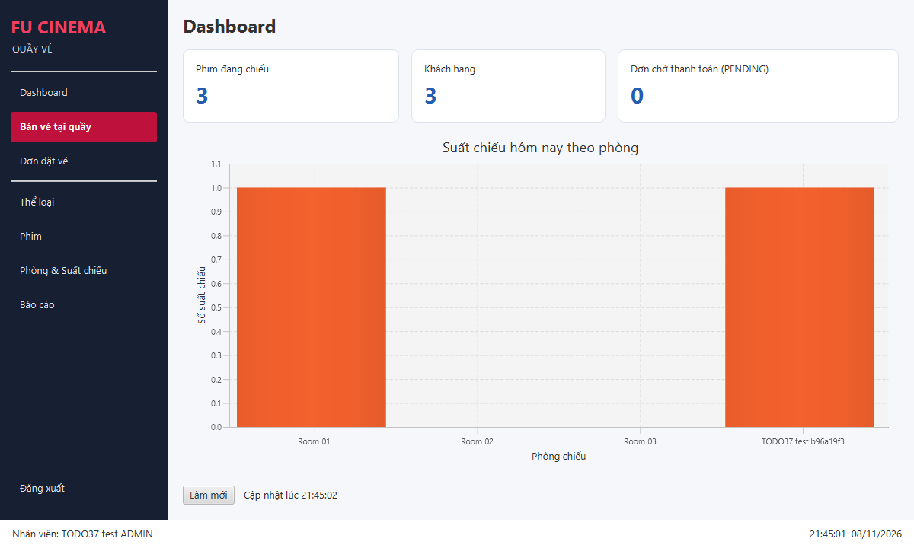
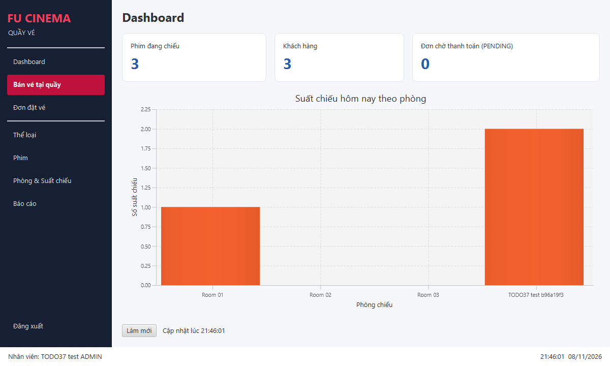

# TODO 37 — Desktop Dashboard

Dashboard nằm tại `/desktop/fxml/dashboard.fxml`. Khi tích hợp với TODO 33–34,
nạp FXML bằng `FXMLLoader` với `setControllerFactory(applicationContext::getBean)`
và đặt root vào vùng nội dung của cửa sổ chính.

Màn hình dùng cùng bốn service với `/admin` của web: số phim đang chiếu,
số khách hàng, số đơn PENDING và số suất chiếu hôm nay theo phòng.
Các truy vấn chạy qua `FxAsync` trong `Task` trên virtual thread; cập nhật giao diện
trên FX thread. Nút Làm mới và chỉ báo tải bind với trạng thái đang tải để tránh
truy vấn chồng nhau. CSS nằm trong vùng Long của `desktop/css/desktop.css`.

Mỗi lần màn hình được gắn vào Scene, Dashboard tải dữ liệu và bắt đầu Timeline
60 giây. Khi rời Scene, Timeline dừng và tác vụ đang tải bị huỷ. Khi tải lỗi,
giữ dữ liệu đã hiển thị và cho phép làm mới để thử lại. Thông báo không có suất
hiển thị khi danh sách rỗng hoặc tất cả phòng đều có số suất bằng 0.

## Kiểm thử tự động

```shell
mvn -Dtest=DashboardFacadeTest test
mvn -Dtest=DashboardIntegrationTests test
mvn -Dtest=DashboardUiTests -Ddesktop.ui.tests=true test
mvn -Dtest=DashboardSqlServerUiTests -Ddashboard.sql.tests=true test
```

Kiểm tra ánh xạ đủ ba KPI, số suất theo phòng, ngày không có suất và việc truy vấn
lại dữ liệu khi làm mới. Integration test đối chiếu dữ liệu web/desktop trên H2
ở chế độ MSSQLServer. Test JavaFX kiểm tra nạp FXML, hiển thị KPI, dừng timer,
binding nút/chỉ báo tải, các phòng có 0 suất và tải lại sau lỗi.

`DashboardSqlServerUiTests` chỉ chạy khi bật cờ riêng và có cấu hình `local`
trỏ tới SQL Server. Test giữ `ddl-auto=validate`, tạo phòng có tên UUID riêng,
tạo hai suất OPEN hôm nay qua endpoint Spring MVC bằng MockMvc có CSRF,
rồi kiểm tra Dashboard JavaFX thật trên cùng DB. Test dùng session ADMIN trong
fixture, không bỏ kiểm tra quyền ở code sản phẩm. Sau test, chỉ các suất/phòng
do test tạo được xoá; không dùng profile `test`/`create-drop` trên SQL Server.

Test này chờ Timeline sản phẩm đủ 60 giây, không thay đổi tốc độ hoặc gọi tay
callback timer. Nó cũng kiểm tra timer dừng khi tháo root và chạy lại khi gắn root.

## Bằng chứng kiểm tra ngày 08/11/2026

JDK Microsoft 21.0.12.1. Lượt chạy đầy đủ có bật native JavaFX và SQL Server:
`clean verify` thành công, **40 test, 0 failure, 0 error, 0 skip** trước khi
đồng bộ các chức năng mới nhất của nhóm từ `develop`.

Sau khi đồng bộ `develop` tại `1e19bfa`, `mvn clean verify` cũng thành công:
**50 test được phát hiện, 39 chạy pass, 11 native/SQL được skip theo cờ mặc định**.
Đợt tích hợp phát hiện code bán vé dùng nhầm record `MovieItem` của màn hình phim;
đã tách `CounterMovieItem` theo quy ước phân công và kiểm tra lại toàn bộ build/test.
Không thay đổi service, repository hoặc entity backend.

| Tiêu chí I25 / issue #72 | Bằng chứng |
|---|---|
| Ba KPI và BarChart theo phòng | FXML JavaFX thật; ảnh dưới đây và DashboardUiTests |
| Facade dùng service cũ, trả record trong transaction | DashboardFacade, DashboardFacadeTest và DashboardIntegrationTests |
| Làm mới thủ công/timer 60 giây qua FxAsync, dừng khi rời màn hình | DashboardSqlServerUiTests trên SQL Server; DashboardUiTests kiểm tra lifecycle |
| Số liệu khớp `/admin`, web tạo suất mới rồi desktop thấy thay đổi | GET `/admin` và POST `/admin/showtimes/new` qua Spring MVC/MockMvc trên SQL Server; kiểm tra các cột JavaFX tăng 0 → 1 → 2 |
| Trạng thái tải/rỗng/lỗi, build/test | DashboardUiTests kiểm tra binding, chống tải chồng, phòng 0 suất, lỗi nghiệp vụ và thử lại |

TC-D04 phần số liệu Dashboard đã được đối chiếu tự động trên SQL Server và qua
ảnh web/desktop người dùng cung cấp. TC-D05 được kiểm tra tự động với endpoint
tạo suất mới, dữ liệu SQL Server và giao diện JavaFX; thao tác tạo mới bằng trình
duyệt chưa được agent điều khiển. Đây không phải bằng chứng kiểm thử quyền/login
hoặc tranh chấp ghế của các TODO khác.

Ảnh snapshot từ native JavaFX, cùng SQL Server local; người dùng hiển thị là
ADMIN fixture và phòng `TODO37 test ...` là dữ liệu tạm đã được dọn:





Để chạy toàn bộ test native mà mỗi lớp có toolkit JavaFX riêng:

```shell
mvn -Ddesktop.ui.tests=true -Ddashboard.sql.tests=true -DreuseForks=false clean verify
```

Các test Dashboard native/SQL mặc định tắt để không yêu cầu SQL Server cá nhân
trong lượt test H2. Một số test module khác trong `develop` có thể vẫn cần desktop.
`reuseForks=false` tránh dùng lại JVM sau `Platform.exit()`.

## Kiểm tra giao diện sau khi tích hợp TODO 33–34

- Mở Dashboard, đối chiếu ba KPI và biểu đồ với `/admin` trên cùng cơ sở dữ liệu.
- Tạo suất chiếu hôm nay trên web, bấm Làm mới và kiểm tra cột phòng tương ứng.
- Tạo thêm suất chiếu trên web, chờ 60 giây và kiểm tra cập nhật tự động.
- Chuyển sang màn hình khác, kiểm tra không còn truy vấn định kỳ của Dashboard.
- Quay lại Dashboard, kiểm tra tải dữ liệu ngay và tiếp tục tự cập nhật.
- Với ngày không có suất, kiểm tra biểu đồ rỗng và thông báo tương ứng.
- Ngắt kết nối cơ sở dữ liệu, kiểm tra thông báo lỗi và nút Làm mới hoạt động lại.

Kiểm thử tự động không thay thế việc chạy TC-D04/TC-D05 trên web và desktop
cùng database SQL Server. Chỉ đánh dấu các bước kiểm tra thủ công khi đã chạy
và có kết quả thực tế.
