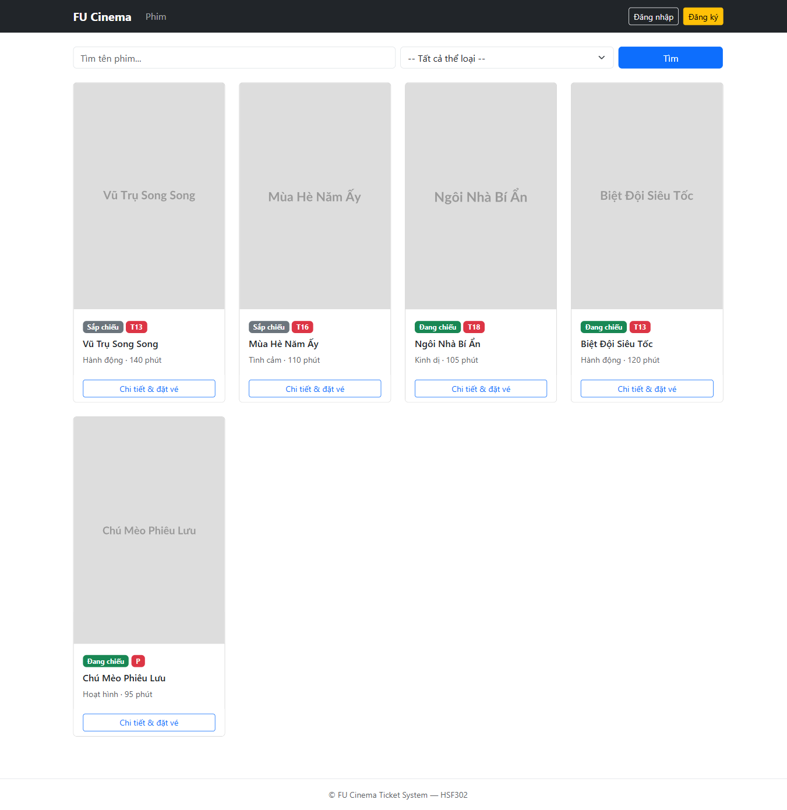
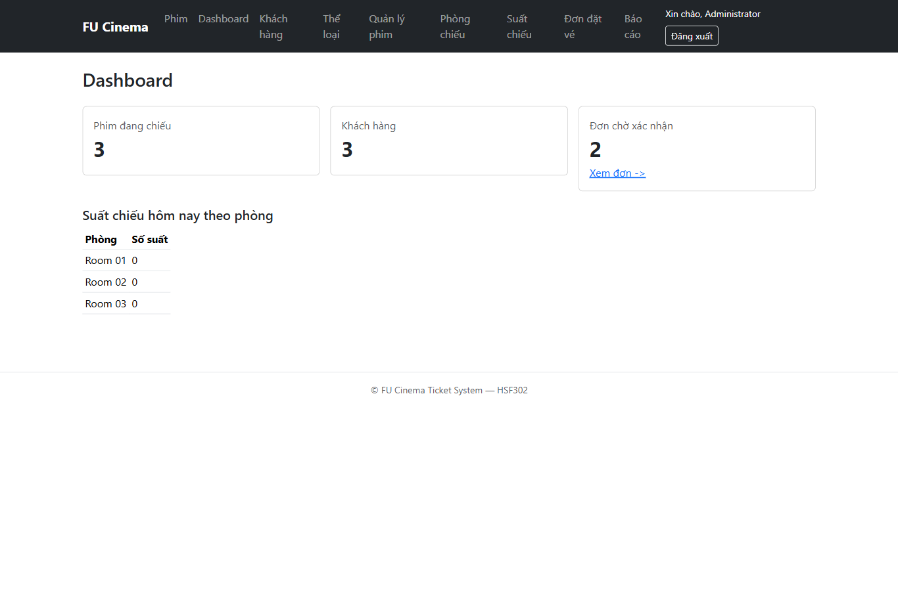
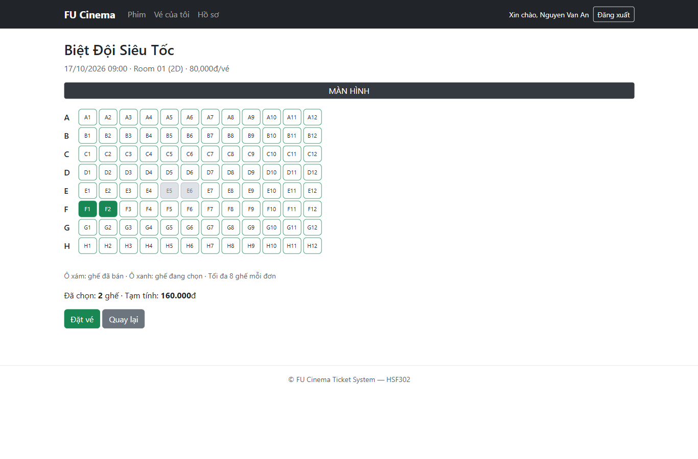
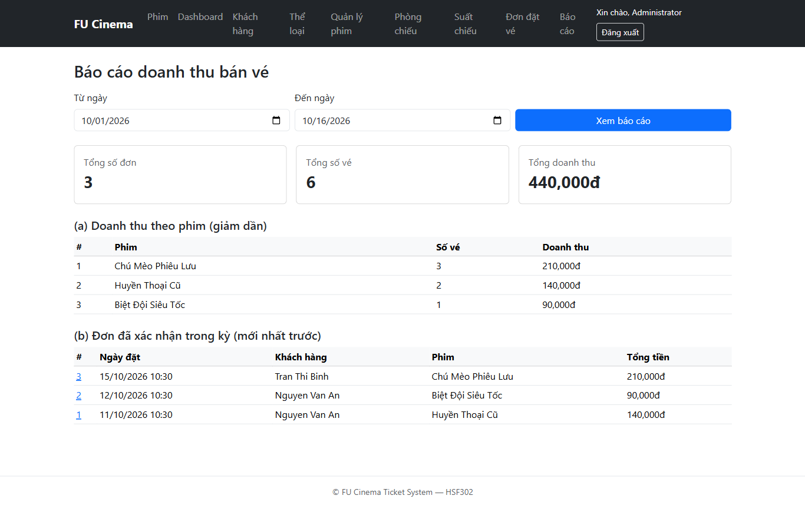

# I19 Nghiệm thu và chuẩn bị phát hành
Issue GitHub: #48 · TODO 32 · ngày kiểm tra: 16/10/2026.

## Kết quả đã thực hiện
- Nhánh tài liệu `docs/19-readme` đã push và merge qua PR #49 vào develop ngày 20/10/2026 tại `57f42e9`.
- Ba commit theo solution: `0569b8a` smoke test; `7e607f2` README/tài khoản/ảnh; `4da2046` phân công. Các commit cũ ghi `Refs #46`; kiểm tra GitHub xác nhận I19 là #48, còn #46 là issue poster. Các bước phát hành mới tham chiếu #48.
- `mvn clean verify` đạt trên worktree sạch và trên bản clone cục bộ sạch; một smoke test contextLoads, không failure/error, profile test/H2, không cần SQL Server.
- Bản clone là clone từ repo cục bộ của nhánh chưa push; chưa thể xác nhận clone nhánh đó trực tiếp từ GitHub.
- Nghiệm thu giao diện/nghiệp vụ bằng Chromium/Playwright trên SQL Server riêng `FUCinemaI19Acceptance20261016`, collation UTF-8, từ code `3d10621`. Database dự án cá nhân không bị dùng để tạo/sửa/xóa dữ liệu thử.
- 79 kiểm tra cuối cùng đạt (76 trình duyệt/HTTP và 3 kiểm tra trực tiếp SQL). Có thử cưỡng bức lỗi khi insert Ticket: transaction rollback cả Booking và Ticket, số bản ghi giữ nguyên 9 đơn/14 vé; trang 500 không lộ thông báo nội bộ.
- Các lượt probe ban đầu thiếu Referer, chọn sai selector hoặc ghép sai URL đã được sửa và chạy lại; bảng dưới ghi kết quả cuối cùng.
- Bốn ảnh đã có trong `docs/images/`: home.png, admin-dashboard.png, seat-selection.png, revenue-report.png.
- Bỏ qua responsive theo yêu cầu của bạn.
- Họ tên/MSSV để trống theo yêu cầu. Không sửa định dạng hoặc tự chèn ảnh vào chỗ trống của báo cáo Word.

## Điều kiện chưa hoàn tất trước release
- Đã kiểm tra `main` tại `3d10621` là tổ tiên của develop tại `57f42e9`; hai sửa lỗi TODO 23 đã có trong develop.
- Bản sửa Unicode của 5 entity vẫn là thay đổi chưa commit trong working tree; không nằm trong ba commit I19 vì yêu cầu trước đó là không commit. README hướng dẫn database mới dùng UTF-8, đã được nghiệm thu riêng. Muốn phát hành cả mapping NVARCHAR cần xử lý riêng các thay đổi này và chạy lại kiểm tra trên SHA phát hành.
- Báo cáo nộp bài: `Report_Assignment1_HSF302.docx` ở gốc repo, đã được người dùng bổ sung ảnh. Ngày 20/10/2026 mở kiểm tra bằng python-docx thành công, có 60 ảnh inline; chưa kiểm tra bố cục bằng render. Cần đối chiếu thông tin nhóm và cập nhật mục lục trước khi nộp.
- API GitHub chưa ghi nhận approval trên PR tài liệu #49. PR release cần reviewer chạy Maven và approve. Repo có cộng tác viên `traltb-byte` với quyền Write; cần nhóm xác nhận tài khoản giảng viên.
- Chưa tạo tag, chưa publish GitHub Release, chưa đóng issue #48.
- Không xác nhận issue I19 Done chỉ dựa vào các kiểm tra cục bộ.

## Chuẩn bị release ngày 20/10/2026
- Tạo `release/1.0.0` từ `origin/develop` tại `57f42e9` trong worktree sạch, không mang theo 5 entity Unicode chưa commit.
- Maven artifact version được đặt thành `1.0.0`.
- Build bản release bằng `mvn -B -o clean verify`: 1 test, 0 failure/error. Kết quả kiểm tra tại SHA cuối cùng được ghi trong PR release.
- Báo cáo Word mở được bằng python-docx, có 60 ảnh inline; chưa render xác nhận bố cục. Tên/MSSV trong README vẫn để trống theo yêu cầu trước đây.
- 79 kiểm tra SQL Server/Playwright bên dưới là bằng chứng lịch sử ngày 16/10 tại `3d10621`; không phải lần chạy lại tại SHA release ngày 20/10.
- Chỉ tạo tag và GitHub Release sau khi đủ review/approval, hoàn tất các điều kiện nghiệm thu và merge PR release vào main.

## Bảng kết quả nghiệm thu
| STT | Kiểm tra | Kết quả |
|---|---|---|
| 1 | Guest home and Unicode | Đạt |
| 2 | Guest redirects to login | Đạt |
| 3 | 404 /movies/999999999 | Đạt |
| 4 | 404 /movies/abc | Đạt |
| 5 | Wrong password rejected | Đạt |
| 6 | Duplicate registration email rejected | Đạt |
| 7 | Invalid registration mobile rejected | Đạt |
| 8 | Underage registration rejected | Đạt |
| 9 | Valid registration redirects | Đạt |
| 10 | Registration creates authenticated session | Đạt |
| 11 | Admin destination | Đạt |
| 12 | Admin denied customer area | Đạt |
| 13 | SQL Server report totals | Đạt |
| 14 | Genre with movies cannot be deleted | Đạt |
| 15 | Admin page /admin/customers | Đạt |
| 16 | Admin page /admin/movies | Đạt |
| 17 | Admin page /admin/rooms | Đạt |
| 18 | Admin page /admin/showtimes | Đạt |
| 19 | Admin page /admin/bookings | Đạt |
| 20 | Customer search | Đạt |
| 21 | Customer destination | Đạt |
| 22 | Customer denied admin | Đạt |
| 23 | Other customer booking hidden | Đạt |
| 24 | Sold and cancelled seats | Đạt |
| 25 | Multi-seat booking | Đạt |
| 26 | No seats | Đạt |
| 27 | Too many seats | Đạt |
| 28 | Invalid seat | Đạt |
| 29 | Already sold seat | Đạt |
| 30 | Rejected bookings leave no extra orders | Đạt |
| 31 | Concurrent seat claims SQL Server | Đạt |
| 32 | Owner cancels future booking | Đạt |
| 33 | Past booking cannot be cancelled | Đạt |
| 34 | Profile duplicate mobile rejected | Đạt |
| 35 | Profile Unicode and session name | Đạt |
| 36 | Profile cannot change username | Đạt |
| 37 | Wrong current password rejected | Đạt |
| 38 | Watched customer can review | Đạt |
| 39 | Review update keeps one rating | Đạt |
| 40 | Age restriction T18 | Đạt |
| 41 | Unwatched customer has no review form | Đạt |
| 42 | Valid password change | Đạt |
| 43 | New password authenticates | Đạt |
| 44 | Genre create Unicode | Đạt |
| 45 | Genre update | Đạt |
| 46 | Movie create Unicode | Đạt |
| 47 | Movie update | Đạt |
| 48 | Room create and capacity | Đạt |
| 49 | Duplicate room rejected | Đạt |
| 50 | Showtime create | Đạt |
| 51 | Sequential overlapping showtime rejected | Đạt |
| 52 | Concurrent create SQL Server | Đạt |
| 53 | Only one overlapping row persisted | Đạt |
| 54 | Concurrent create versus update SQL Server | Đạt |
| 55 | Update/create leaves one occupied time slot | Đạt |
| 56 | Room layout locked after scheduling | Đạt |
| 57 | Movie with showtimes is soft deleted | Đạt |
| 58 | Room with showtimes goes to maintenance | Đạt |
| 59 | Admin confirms pending booking | Đạt |
| 60 | Confirm again rejected | Đạt |
| 61 | Admin cancellation | Đạt |
| 62 | Cancel again rejected | Đạt |
| 63 | Edit cancellation cancels bookings SQL Server | Đạt |
| 64 | Delete showtime cancels bookings SQL Server | Đạt |
| 65 | Admin creates customer with account | Đạt |
| 66 | Admin updates customer without changing password | Đạt |
| 67 | Admin locks customer | Đạt |
| 68 | Admin unlocks customer | Đạt |
| 69 | Delete customer without bookings | Đạt |
| 70 | Delete customer with bookings locks account | Đạt |
| 71 | Delete empty genre | Đạt |
| 72 | Delete room without showtimes | Đạt |
| 73 | Q11 native SQL Server counts today OPEN | Đạt |
| 74 | Report rejects reversed date range | Đạt |
| 75 | Report shows empty period | Đạt |
| 76 | Simulated SQL insert failure returns custom 500 without leak | Đạt |
| 77 | SQL Server rollback after Ticket insert failure: Booking/Ticket counts unchanged | Đạt |
| 78 | SQL Server: no duplicate active seat claims | Đạt |
| 79 | SQL Server: eight identity primary-key tables | Đạt |

## Thứ tự PR
1. PR đồng bộ trước tài liệu: main → develop, merge commit; đưa hai bản sửa TODO 23 đã review về develop.
2. PR docs/19-readme → develop: ba commit I19, một smoke test và bốn ảnh; dùng Refs #48.
3. Sau khi PR tài liệu được review/merge và các mục còn thiếu được xử lý, tạo release/1.0.0 từ develop đã cập nhật; chạy lại kiểm thử tại đúng SHA.
4. PR release/1.0.0 → main, đủ approval theo teamwork, dùng Create a merge commit.
5. Chỉ sau merge release: tag v1.0.0 và GitHub Release, rồi PR main → develop; chỉ đóng #48 khi đủ các tiêu chí.

## PR 1 Đồng bộ main về develop
Tiêu đề: `chore(showtime): sync reviewed fixes into develop`
Head: `main` · Base: `develop` · Merge commit.

```markdown
## Mô tả
Đồng bộ hai bản sửa TODO 23 đã merge vào main: hủy đơn khi sửa suất sang CANCELLED và khóa phòng khi kiểm tra/lưu lịch chiếu. Giữ cùng lịch sử giữa hai nhánh trước khi tích hợp tài liệu I19.
Refs #48

## Loại thay đổi
- [ ] feat
- [ ] fix
- [ ] refactor
- [ ] docs
- [x] chore
- [ ] test

## Cách kiểm thử
1. Kiểm tra diff chỉ có hai sửa lỗi đã review.
2. Kiểm thử hủy qua form sửa, tạo đồng thời và tạo/sửa đồng thời cùng phòng.
Kết quả mong đợi: đơn được hủy cùng suất; không tạo hai suất trùng lịch. Tác giả đã kiểm chứng trên SQL Server riêng tại 3d10621.

## Ảnh chụp màn hình

## Checklist
- [x] Tiêu đề PR theo Conventional Commits
- [ ] Đã rebase/merge develop mới nhất
- [ ] `mvn verify` → `BUILD SUCCESS` trên máy mình tại SHA merge
- [x] Đã tự test các trường hợp chính và trường hợp lỗi
- [x] Controller không gọi repository; nghiệp vụ nằm ở service
- [x] Không chứa mật khẩu/thông tin nhạy cảm
- [x] Đã cập nhật README (nếu cần) — không cần cho PR đồng bộ
```

## PR 2 Tài liệu I19
Tiêu đề: `docs(readme): add setup guide and release documentation`
Head: `docs/19-readme` · Base: `develop`.
Chỉ mở/merge sau PR đồng bộ để diff tập trung vào I19.

```markdown
## Mô tả
Bổ sung smoke test H2, README theo phiên bản công nghệ thực tế, hướng dẫn SQL Server UTF-8, cấu hình local/test, tài khoản seed, URL và bốn ảnh màn hình. Thêm phân công nhóm hai người; họ tên/MSSV để trống theo yêu cầu.
Bổ sung ba template GitHub, biên bản `release.md` và báo cáo `Report_Assignment1_HSF302.docx` ở gốc repo; test/docs cá nhân khác vẫn bị ignore.
Refs #48

## Loại thay đổi
- [ ] feat
- [ ] fix
- [ ] refactor
- [x] docs
- [ ] chore
- [x] test

## Cách kiểm thử
1. Clone nhánh vào thư mục mới, chạy Maven Wrapper verify: contextLoads dùng H2 và không cần SQL Server.
2. Tạo database SQL Server UTF-8 theo README, cấu hình file local đã ignore, chạy ứng dụng.
3. Kiểm tra tài khoản mẫu, URL và các ảnh README.
4. Đối chiếu biên bản nghiệm thu: 79 kiểm tra trên SQL Server riêng; không coi smoke test là toàn bộ kiểm thử nghiệp vụ.
Kết quả mong đợi: build thành công, ứng dụng chạy và tài liệu khớp phiên bản/code thực tế.

## Ảnh chụp màn hình





## Checklist
- [x] Tiêu đề PR theo Conventional Commits
- [ ] Đã rebase/merge develop mới nhất sau PR đồng bộ
- [x] `mvn verify` → `BUILD SUCCESS` trên máy mình
- [x] Đã tự test các trường hợp chính và trường hợp lỗi
- [x] Controller không gọi repository; nghiệp vụ nằm ở service
- [x] Không chứa mật khẩu/thông tin nhạy cảm
- [x] Đã cập nhật README (nếu cần)
```

## PR 3 Release v1.0.0
Tiêu đề: `release: v1.0.0`
Head: `release/1.0.0` · Base: `main` · Create a merge commit.
Mẫu này chỉ dùng sau khi đã tạo nhánh release từ develop đã tích hợp đủ.

```markdown
## Mô tả
Chuẩn bị v1.0.0 của FU Cinema Ticket System với các chức năng Assignment 1 và tài liệu cài đặt.
Refs #48

## Loại thay đổi
- [ ] feat
- [ ] fix
- [ ] refactor
- [ ] docs
- [x] chore
- [ ] test

## Cách kiểm thử
1. Tác giả và reviewer checkout release/1.0.0, chạy mvn verify.
2. Chạy lại checklist Guest/Admin/Customer, transaction, tranh ghế, lịch chiếu và báo cáo trên SQL Server tại đúng SHA release.
3. Kiểm tra README, báo cáo Word, ảnh và quyền truy cập của giảng viên.
Kết quả mong đợi: đủ tiêu chí issue #48, không có blocker, đủ approvals trước merge.

## Ảnh chụp màn hình

## Checklist
- [x] Tiêu đề PR theo Conventional Commits
- [ ] Đã rebase/merge develop mới nhất
- [ ] `mvn verify` → `BUILD SUCCESS` trên máy mình tại SHA release
- [ ] Đã tự test các trường hợp chính và trường hợp lỗi tại SHA release
- [ ] Controller không gọi repository; nghiệp vụ nằm ở service
- [ ] Không chứa mật khẩu/thông tin nhạy cảm
- [ ] Đã cập nhật README (nếu cần)
```

## PR 4 Đồng bộ sau release
Tiêu đề: `chore(release): merge v1.0.0 back into develop`
Head: `main` · Base: `develop` · Create a merge commit.

```markdown
## Mô tả
Đồng bộ commit phát hành v1.0.0 về develop sau khi PR release đã merge, tag và GitHub Release đã được tạo.
Closes #48

## Loại thay đổi
- [ ] feat
- [ ] fix
- [ ] refactor
- [ ] docs
- [x] chore
- [ ] test

## Cách kiểm thử
1. Kiểm tra v1.0.0 trỏ đúng commit phát hành trên main và GitHub Release tồn tại.
2. Kiểm tra develop nhận đầy đủ lịch sử phát hành; chạy lại mvn verify.
3. Xác nhận báo cáo, ảnh, thông tin nhóm và quyền giảng viên đã hoàn tất.
Kết quả mong đợi: main/develop đồng bộ; issue #48 đủ điều kiện Done.

## Ảnh chụp màn hình

## Checklist
- [x] Tiêu đề PR theo Conventional Commits
- [ ] Đã rebase/merge develop mới nhất
- [ ] `mvn verify` → `BUILD SUCCESS` trên máy mình
- [ ] Đã tự test các trường hợp chính và trường hợp lỗi
- [ ] Controller không gọi repository; nghiệp vụ nằm ở service
- [ ] Không chứa mật khẩu/thông tin nhạy cảm
- [ ] Đã cập nhật README (nếu cần)
```

## Bản nháp release notes
Chỉ dán vào GitHub Release sau khi PR release được review/merge:

```markdown
FU Cinema Ticket System v1.0.0
- Quản lý khách hàng/tài khoản, thể loại, phim, phòng, lịch chiếu và đơn đặt vé.
- Đăng ký/đăng nhập bằng session, phân quyền Admin/Customer và CSRF.
- Chọn nhiều ghế trong một transaction, giới hạn tuổi, hủy đơn và quản lý hồ sơ.
- Báo cáo doanh thu theo kỳ và đánh giá phim đã xem.
- Sửa hủy suất qua form chỉnh sửa và kiểm tra lịch chiếu đồng thời theo phòng.
- README cài đặt Windows, SQL Server UTF-8, H2 smoke test và ảnh minh họa.

Yêu cầu: Java 21+, SQL Server 2019+ theo hướng dẫn UTF-8; dùng Maven Wrapper.
Cấu hình kết nối cá nhân không có trong repository; làm theo README.
```

## Hồ sơ bằng chứng cục bộ
- `.tmp/issue19/verify.log`, `fresh-clone-verify.log`: build/smoke test.
- `.tmp/issue19/acceptance-results.json`: các lượt kiểm tra và kết quả cuối.
- `.tmp/issue19/rollback-before.txt`: số đơn/vé trước thử rollback.
- Báo cáo Word được sao chép nguyên trạng vào gốc repo, giữ nguyên nội dung và định dạng do người dùng cung cấp; không tự xác nhận hoàn thành release.
